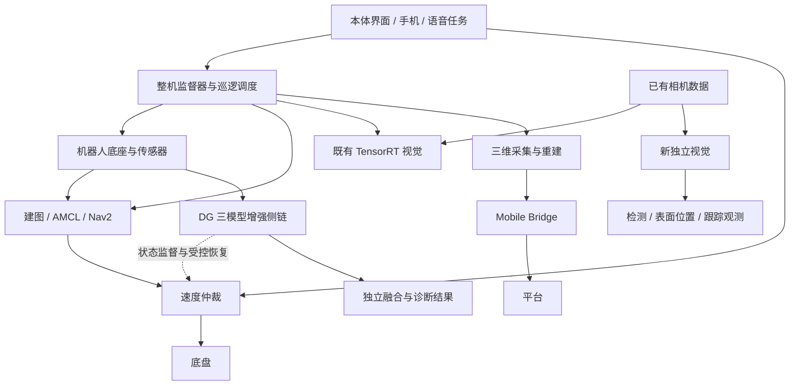

# DG-202611 仓库梳理

记录日期：2026-10-20。用途：说明当前有哪些版本、各部分承担什么职责、为什么容易混淆，方便后续决定整理范围。

本轮仅阅读本地文件、Git 状态、GitHub 元数据和关键源码。未修改原仓库，未运行项目脚本、测试、构建或哈希校验，未连接机器人、虚拟机或 RDK，未提交、推送、合并或更改仓库设置。本文件是另存的说明，不是运行验收报告，也不是逐行代码审计。

## 1. 结论

这是一个把机器人基础工程、DG 三模型增强、旧视觉、新独立视觉、界面与云端服务、第三方驱动、实验工具和历史证据放在一起的集成仓库。

目前最明显的混乱来自三个方面：

1. **版本来源分开了。** 本地工作仓库、独立发布仓库的主分支、云端视觉分支、机器人实际部署不是同一个状态。
2. **功能职责交叉。** 名叫 `ylhb_llm` 的包还管理整机进程和界面；名叫 Mobile Bridge 的包还承担巡逻、地图与上传；辅助传感器代码又集中在 `ylhb_base`。
3. **文档描述的是不同阶段。** “完成”“最终报告”“验收”有时指历史阶段结果，有时是待填写模板，不能据标题判断当前整车是否可用。

仓库的主要模块和连接关系已梳理清楚。整车是否可用，本轮未验证。

## 2. 先分清四份状态

| 状态 | 来源 | 本轮看到的内容 | 使用时的边界 |
|---|---|---|---|
| 本地工作目录 | `C:/Users/peng/Documents/工作区1/dg202611_robot_integration` | 原集成项目的历史和大量当前未提交文件；本地新视觉仍是状态空壳 | 当前磁盘内容不等于最后一次 Git 提交 |
| 独立发布仓库 main | `weiyang02520-ops/dg202611_robot_integration` | 2026-10-14 发布的源码快照，新视觉在这个基线仍是空壳 | 不包含原仓库完整历史，也不是机器人整机备份 |
| 云端视觉分支 | 上述发布仓库的 `cursor/vision-v1-offline-1fcf` | 新视觉检测、深度处理、短时跟踪及其说明和工具 | PR #1 仍未合并，不能据此认为 main 或本地已经更新 |
| 机器人实际部署 | Jetson 上的基础工作空间与可能存在的 DG 独立工作空间 | 本地保存了一些历史记录 | 本轮未连接设备，当前活动路径、代码版本及 `res_ds` 位置未知 |

本地工作仓库的 `origin` 仍指向 `liaojingwu20041031/electric-power-inspection-robot`，并没有指向独立发布仓库。因此，不能直接在本地运行普通 `git pull`，就期待拿到云端视觉分支的成果。

版本锚点，供以后定位：

- 本地分支：`codex/dg-robot-integration`；已提交基线：`b4697c8c08480c9f8fe2e0452fb130f888f75880`，另有未提交改动和未跟踪文件。
- 发布仓库 main：`6e8de8f80bc65ce67339bad853529f50b251bdbc`。
- 本轮读取的视觉分支：`178b21b0f998720c3ea2eb8f4125e81832a49ba8`。
- [PR #1](https://github.com/weiyang02520-ops/dg202611_robot_integration/pull/1) 的改动集中在独立视觉两包及相关说明、证据模板和换行配置，不能视为整个导航工程的一次统一升级。

GitHub API 在本轮读取时显示发布仓库为公开。用户说明这是自己主动调整的，并由用户自己管理可见性。本轮未更改此设置。历史文件中的 private 是当时状态。

来源：[发布快照说明](https://github.com/weiyang02520-ops/dg202611_robot_integration/blob/main/SOURCE_SNAPSHOT.json)、GitHub API、本地只读 Git 查询。

## 3. 模块地图

本地 `src` 有 13 个一级目录、16 份 ROS 包声明。ZED 上游目录本身包含 4 个包。

| 分组 | 主要目录或包 | 实际职责 |
|---|---|---|
| 机器人基础与 DG 增强 | `src/ylhb_base` | 底盘、里程计、坐标变换、IMU/GNSS/UWB、建图导航启动、三模型算法与状态管理、速度仲裁、部分辅助传感器接口 |
| 整机编排与界面 | `src/ylhb_llm` | 系统监督器、QML 触摸界面、语音、任务与受控 AI 调度，不只是调用大模型 |
| 网络与业务接口 | `src/ylhb_mobile_bridge` | 本地 HTTP/WebSocket、手机控制、平台连接、地图、巡逻执行、图片与三维资产上传及持久化 |
| 既有视觉 | `src/ylhb_perception` | TensorRT C++ 检测器、深度定位；还保留 Python 检测实现。当前监督器仍启动此包 |
| 新独立视觉 | `src/vision_perception`、`src/vision_perception_interfaces` | 独立检测、深度表面位置与短时跟踪路线；本地空壳与远端开发版本不同 |
| 三维建模 | `src/ylhb_3d_mapping` | ZED SVO 采集、离线重建和空间建图，结果交给业务接口上传 |
| 通用消息 | `src/ylhb_interfaces` | 既有业务消息、服务和动作接口，与新视觉的接口包并列 |
| 上游硬件驱动 | `src/hipnuc_imu`、`src/rplidar_ros-ros2`、`src/zed-ros2-wrapper` | IMU、激光雷达、ZED 接入。ZED wrapper 内含 components、wrapper、debug、元包 |
| RDK 事件相机 | `src/dg_hvs_bridge` | 对接 RDK 厂商 SDK、发布事件相关数据，属于另一块板端的接入线 |
| 合成实验 | `src/dg_synthetic_validation`、`scenarios` | 为算法和恢复流程提供合成输入与场景；不能替代真实相机、真实导航或真车精度证据 |
| 工具与运维脚本 | `scripts`、`tools/route_map_tool` | 部署、启动包装、采集、离线评估、路线编辑等，执行副作用各不相同 |
| 参考资料 | `docs`、`evidence`、`官方通信协议`、`CAD`、`记录照片`、`UI_sc` | 设计、历史记录、原始日志、协议和素材。`UI_sc` 是图片，实际界面源码在 `ylhb_llm/qml` |

CAD 中出现机械臂结构，不代表仓库已有机械臂控制软件。当前 ROS 包清单中没有独立的机械臂或 MoveIt 控制包。

## 4. 整套系统的关系

此图表示源码中的职责关系，不表示全部模块已经部署或联通。新独立视觉尚未接入现有监督器的启动表。

### 原有导航与三模型不是同一个层次

- 原有基础链：底盘里程计和 IMU进入 EKF（合并基础运动信息），激光进入 SLAM/AMCL（建图与定位），Nav2 负责路线运动。
- MODEL-1：多源位置融合和质量门控，输出 `/dg/fusion/*`。源码明确不接管 `map → odom` 坐标变换，当前 Nav2 配置也没有直接消费这些融合话题。
- MODEL-2：扫描过滤、稳定几何特征、动态候选和质量信息；包含事件相机、毫米波辅助接口。
- MODEL-3：定位异常监督、停稳、旋转扫描、候选验证、恢复或人工处理。是算法与状态管理流程，不能把“三模型”理解成三套已经训练好的神经网络。

因此，“融合话题有输出”和“机器人已经用融合结果导航”是两种不同结果。

关键依据：[融合节点](</C:/Users/peng/Documents/工作区1/dg202611_robot_integration/src/ylhb_base/scripts/multisource_fusion_node.py:265>)、[DG 集成入口](</C:/Users/peng/Documents/工作区1/dg202611_robot_integration/src/ylhb_base/launch/dg_navigation_integration.launch.py:354>)。

## 5. 三类启动入口要分开看

| 入口 | 作用 | 本轮从代码读到的默认行为 |
|---|---|---|
| `bringup.launch.py` | 真实硬件底座 | 默认启动真实底盘链与 `/cmd_vel` 速度仲裁器 |
| `navigation.launch.py` / `navigation_keepout.launch.py` | 常规导航 | 启动 Nav2/AMCL；监督器另行控制自动激活时机 |
| `dg_navigation_integration.launch.py` | DG 增强观察与集成 | 默认不开 Nav2 和速度仲裁器，命令输出参数默认 `/dg/test_cmd_vel` |
| `run_dg_inspection.sh` | 生产界面包装入口 | 当前脚本转到基础 `/home/nvidia/ros2_DL` 的界面，不覆盖 `ylhb_llm`；Mobile Bridge 交给 systemd 服务管理 |
| `vision.launch.py` | 新独立视觉 | 远端默认仍是 skeleton；检测、三维输出和跟踪需要显式参数开启 |

两处需要保留的问题：

1. 旧 `ROBOT_INTEGRATION_READY.md` 仍称 `run_dg_inspection.sh` 会加载 DG 覆盖层预览新界面，当前脚本已经改成基础界面。后续接手应以当前脚本为准。
2. 当前本地监督器的普通导航命令没有显示将 `/cmd_vel` 重映射到 `/cmd_vel_nav`，而 DG 集成入口有此映射；底座又默认启动仲裁器。这是静态阅读发现的衔接疑点，尚不能认定设备运行故障，因为机器人可能部署的是另一版本。

依据：[生产包装脚本](</C:/Users/peng/Documents/工作区1/dg202611_robot_integration/scripts/run_dg_inspection.sh:4>)、[监督器导航命令](</C:/Users/peng/Documents/工作区1/dg202611_robot_integration/src/ylhb_llm/ylhb_llm/system_supervisor_node.py:2049>)、[DG 导航映射](</C:/Users/peng/Documents/工作区1/dg202611_robot_integration/src/ylhb_base/launch/dg_navigation_integration.launch.py:533>)。

## 6. 两套视觉必须分开

| 项目 | 旧视觉 | 新独立视觉的远端开发版本 |
|---|---|---|
| 位置 | `ylhb_perception` | `vision_perception` 与独立接口包 |
| 推理路线 | TensorRT/CUDA | YOLO11n-seg ONNX、CPU 推理 |
| 主要输出 | `/perception/*`，旧业务格式 | `/dg/vision/*`，新消息定义 |
| 总控关系 | 已在现有监督器进程表内 | 尚未进入现有监督器进程表 |
| 本轮可确认范围 | 源码及配置存在 | 远端确有检测、深度配对/表面采样、按类 IoU 短时跟踪代码 |
| 当前实机可用性 | 本轮未验证 | 本轮未验证；不代表已经接入 ZED 或达到精度要求 |

远端 V1–V3 的含义：

- V1：图像订阅、ONNX 检测和二维结果输出。
- V2：配对 RGB/深度/相机内参，输出有有效性标记的可见表面位置。没有合格深度时应报告无效，不是抓取位姿。
- V3：按类别和二维交叠率做短时身份关联，源码是确定性贪心匹配。
- 默认仍为 skeleton；三维和跟踪默认关闭；姿态保持无效，`arm_ready=NO`。

**交接文件也有接口描述过时的问题。** 桌面 `LOCAL_HANDOFF.md` 的阶段表称 V1 输出 `vision_msgs/Detection2DArray`；本轮读取的远端节点实际导入并发布 `vision_perception_interfaces/VisionDetectionArray`。订阅端应按具体版本的真实接口接线，不能只照交接表。

依据：[本地空壳说明](</C:/Users/peng/Documents/工作区1/dg202611_robot_integration/src/vision_perception/README.md:3>)、[总控仍启动旧视觉](</C:/Users/peng/Documents/工作区1/dg202611_robot_integration/src/ylhb_llm/ylhb_llm/system_supervisor_node.py:472>)、[远端消息发布](https://github.com/weiyang02520-ops/dg202611_robot_integration/blob/178b21b0f998720c3ea2eb8f4125e81832a49ba8/src/vision_perception/vision_perception/vision_node.py#L313)、[远端跟踪器](https://github.com/weiyang02520-ops/dg202611_robot_integration/blob/178b21b0f998720c3ea2eb8f4125e81832a49ba8/src/vision_perception/vision_perception/tracker.py#L63)。

## 7. 哪些“完成”不能直接沿用

| 看到的记录 | 应该怎样理解 |
|---|---|
| 早期软件闭合报告 COMPLETE | 当时指定范围的阶段结论，不是整车闭环通过 |
| 历史合成场景 PASS | 合成输入下的流程结果，不是实际定位精度或实车恢复成功率 |
| 已保存真实 UWB、RDK 与跨板日志 | 对应历史采集/传输已有记录；不能由此认定三模型已完整消费这些输入 |
| HVS README 仍称跨板未证明 | 是较早快照；后续 09-13 跨板记录记载过业务接收，但仍不证明新版 MODEL-2 已消费 |
| 毫米波资料、接口已存在 | 当前本地记录仍将真实原始数据采集列为待办 |
| `REAL_ROBOT_ACCEPTANCE.md` | 有待填写字段的验收清单，不是已经完成的验收结果 |
| `artifacts` 中的发布包 | 绑定特定历史版本；不能据此认为包内有今天全部未提交文件 |
| `SOURCE_SNAPSHOT.json` 的 NOT_IMPLEMENTED | 发布时的基线说明，不是后续视觉分支的实时状态 |

本地证据索引仍把 UWB 到 MODEL-1 的真实链、MODEL-3 完整状态闭环和现场运动等列为待完成。本轮未重跑这些工作，也没有重新校验历史数据。

依据：[当前状态说明](</C:/Users/peng/Documents/工作区1/dg202611_robot_integration/CODEX_BURN_STATUS.md:9>)、[历史证据索引](</C:/Users/peng/Documents/工作区1/dg202611_robot_integration/docs/dg202611/FINAL_EVIDENCE_INDEX.md:8>)、[验收清单](</C:/Users/peng/Documents/工作区1/dg202611_robot_integration/docs/dg202611/REAL_ROBOT_ACCEPTANCE.md:20>)。

## 8. 为什么暂时不适合直接清理目录

- 本地仓库地图、新工程文档、视觉两包与计划、证据目录等仍有未跟踪内容；README、评估器和地图相关文件还有未提交修改。只打包 Git 最后提交会漏掉它们。
- 同一功能可能有基础工作空间版本、DG 版本、发布快照版本和视觉开发版本。文件看起来旧，不代表没有被生产入口使用。
- `res_ds` 在本轮检查的本地代码和文档中没有找到引用。它是否独立仓库、存在哪里、与基础工程的关系，仍需读机器人当前目录才能确定。
- 旧视觉、三模型、独立视觉和原厂驱动的硬件依赖不同，不能把它们当成一套可以在 Windows 上统一启动的程序。
- 历史失败、原始日志和旧发布包可能承担证据或回退用途，不能因为名称重复就删除。

因此，当前应先决定后续以哪份代码承担什么职责，再决定合并或整理范围。用户当前只授权了解仓库，本轮未执行备份上传、部署、合并或清理。

## 9. 后续接手的阅读顺序

1. 看本文件的版本来源表，先确认本次要处理的是本地、发布主分支、视觉分支还是设备部署。
2. 看本地 `README.md`、`docs/REPO_MAP.md` 和 `docs/INTEGRATION_SPEC.md`，了解模块职责。
3. 看 `CODEX_BURN_STATUS.md`、`TECH_DEBT.md` 和专题证据索引，确定当前明确的缺口。
4. 要处理启动或接线时，读当前 launch、监督器、配置和真实消息定义，再参考历史操作说明。
5. 涉及机器人当前状态时，另行取得设备的只读目录、版本、服务和话题信息。本说明不能替代这些实时信息。

### 本轮清单

- [x] 区分本地工作目录、独立发布主分支和云端视觉分支。
- [x] 梳理底盘导航、三模型、界面与业务接口、两套视觉、三维建模、驱动和实验目录。
- [x] 找到启动说明、完成口径及视觉接口的具体差异。
- [x] 另存本说明，原仓库保持不变。
- [ ] 机器人当前活动版本、`res_ds` 位置及实际整车流程：未读取、未验证，超出本轮只读仓库梳理范围。
